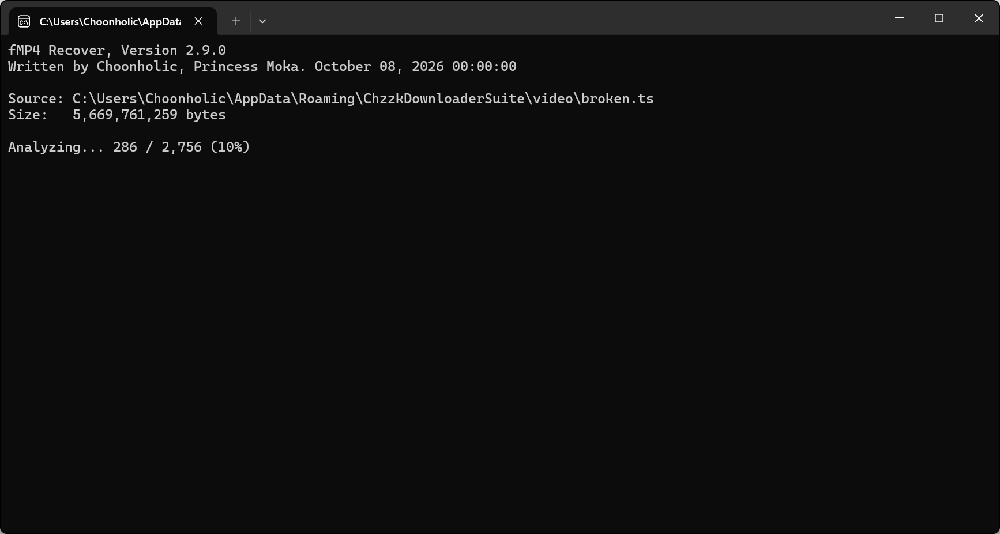

# fMP4 Recover

<div style='text-align: center'>

<p><i>(This image may not reflect the latest information.)</i></p>
</div>

fMP4 Recover is an experimental recovery tool for downloaded Fragmented MP4 (fMP4) files containing damaged segments.

It analyzes the segments in the file, recovers as much valid media data as possible, and creates a new MP4 file.

## Prerequisites

FFmpeg and FFprobe must be installed before using fMP4 Recover.

For installation instructions, see `how_to_install_ffmpeg.en-US.pdf`.

## Usage

Run `fMP4Recover.exe` with the file to recover:

```
.\fMP4Recover.exe "video.ts"
```

You can also drag and drop the file onto `fMP4Recover.exe`.

When recovery is complete, a new file with `_fixed` appended to the original filename will be created in the same directory, as shown below. The original file is not modified and may be deleted after you have verified that the recovery was successful.

```
video.ts
video_fixed.mp4
```

## Limitations

fMP4 Recover is designed to recover specific types of Fragmented MP4 file corruption that have currently been identified and analyzed. Files damaged for other reasons, or with different file structures or corruption patterns, cannot be recovered.

In addition, segments that cannot be recovered are removed from the resulting file, so some video or audio from the affected portions may be missing.

Recovery is only possible when enough valid media data remains in the original file. Keep the original file until you have verified that the recovered MP4 file is valid.
